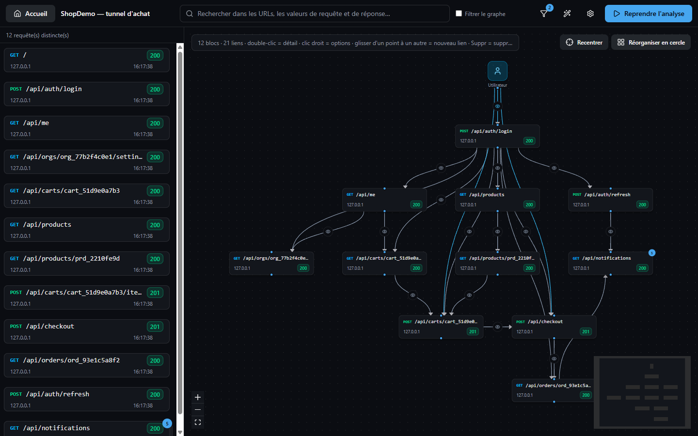
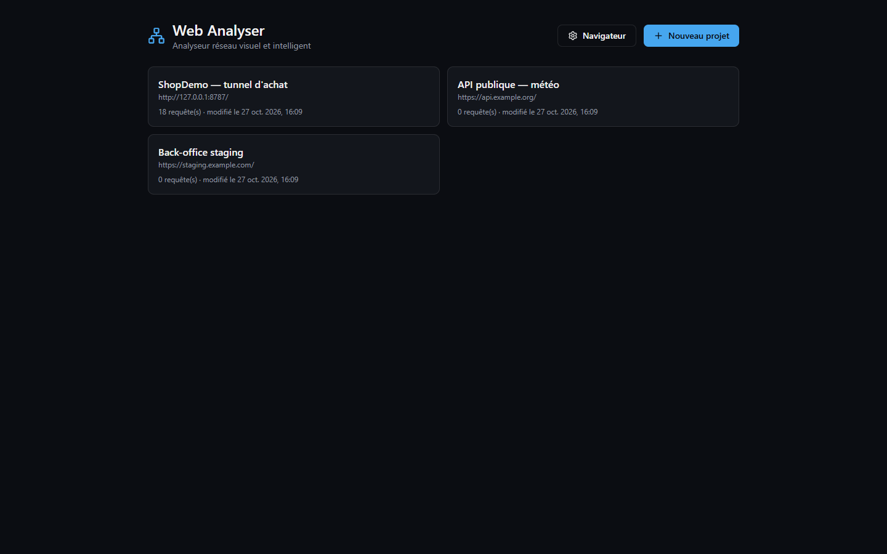
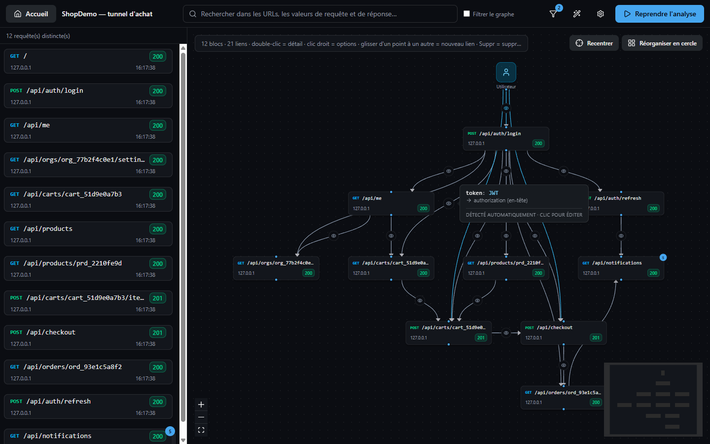
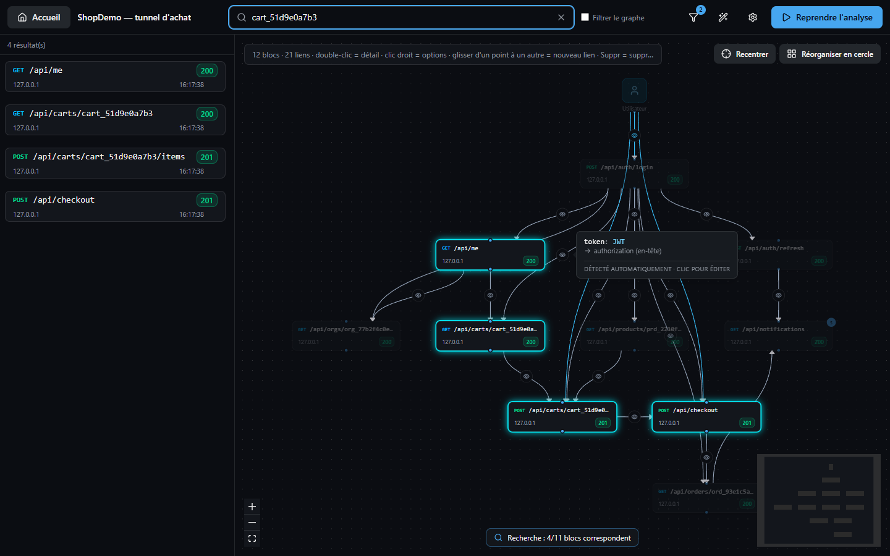
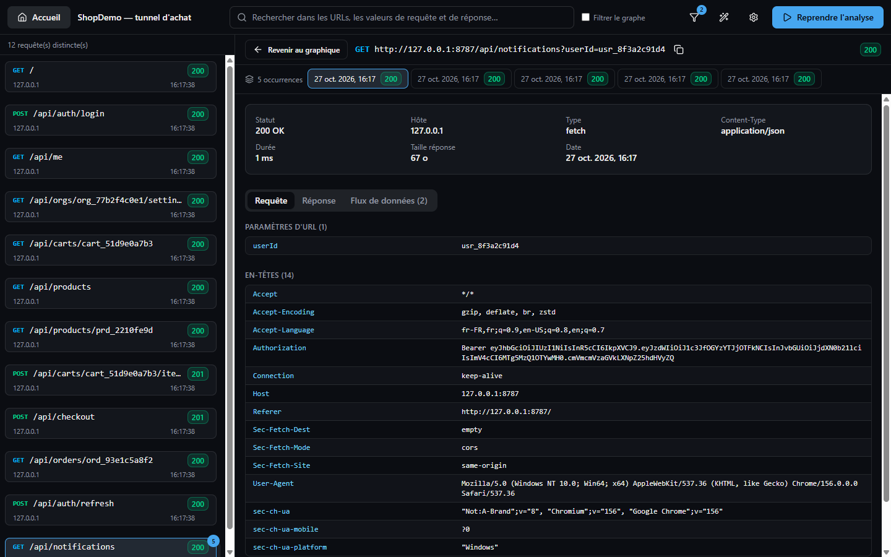
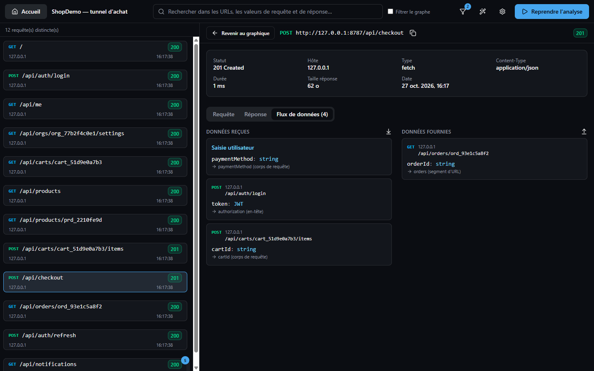
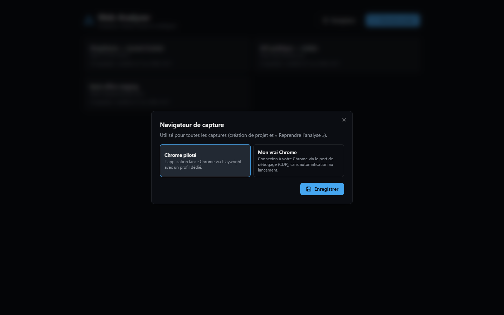

# Web Analyser

**English** | [Français](README.fr.md)

A visual, smart desktop network analyser: it captures the traffic of a real Chrome, stores it in SQLite and
rebuilds the graph of data flows between requests (e.g. the `token` returned by `/login` and reused by `/me`).

Stack: Tauri v2 (Rust + SQLite), React + strict TypeScript (no `any`, no `@ts-ignore`), Tailwind / shadcn/ui,
React Flow, and a Playwright agent driving Chrome. All data stays local.

> The app's user interface is currently in French; UI labels quoted below are followed by their English meaning.



## Features

- **Projects**: list of saved analysis sessions, create a project and start capturing in one click.

  

- **Interactive graph**: infinite canvas (zoom, pan), layered or circular layout, re-centering, and « Voir à
  partir de… » ("View from…", right click) to isolate a node and its descendants. Identical requests are merged
  into a single node with a counter.
- **Automatic correlation**: detects values (JWT tokens, IDs, UUIDs…) returned by a response and then reinjected
  into a later request (header, URL parameter, path segment, body). Hover a link's bubble to see the variables
  flowing through it; links can be edited, created and deleted by hand.

  

- **Global search** across URLs, request values and response values (FTS5); matching nodes are highlighted, and
  the « Filtrer le graphe » ("Filter graph") option hides the others.

  

- **Virtualized request list** (thousands of entries), resizable panel, identical requests stacked with one tab
  per occurrence, glob display filters (e.g. `/_nuxt/*.js`).
- **Detail view**: headers, parameters, body, full response, incoming/outgoing data flows, and a ready-to-copy
  POSIX `curl` command to replay the request.

  
  

- **Choice of browser**: Chrome driven by Playwright, or your own Chrome via CDP (see below).

  

> ⚠️ Captures contain sensitive data (cookies, tokens, typed passwords). They are stored only in the
> application's data folder (`%APPDATA%\dev.webanalyser.app` on Windows) and are never sent anywhere else.

## Download

The GitHub Actions CI ([`build.yml`](.github/workflows/build.yml)) builds installers on every push for
macOS (`.dmg`, Apple Silicon and Intel), Windows (`-setup.exe` NSIS and `.msi`) and Linux (`.AppImage`, `.deb`,
`.rpm`), available as workflow artifacts. Pushing a `v*` tag (e.g. `git tag v0.1.0 && git push --tags`)
creates a draft GitHub release with these files.

- **Node.js ≥ 20** and **Google Chrome** must be installed: the capture agent (bundled in the app) runs with the
  system `node` (can be overridden with the `WEB_ANALYSER_NODE` environment variable).
- Binaries are not signed: on macOS, right click → Open (or `xattr -cr "/Applications/Web Analyser.app"`);
  on Windows, SmartScreen → "More info" → "Run anyway".

## Requirements

- Node.js ≥ 20, stable Rust, Google Chrome installed.
- `npm install`

## Running

```bash
npm run tauri dev      # builds the capture agent, starts Vite and the Tauri app
npm run build:agent && npm run tauri build -- --no-bundle   # release exe in src-tauri/target/release
npm run typecheck      # strict TypeScript (front end + agent)
npm run lint           # ESLint: `any` and `@ts-ignore` are forbidden
cd src-tauri && cargo test
```

Capture browser (« Navigateur » / "Browser" button on the home page, or the gear icon in the workspace), a global
setting stored in SQLite:

- **Driven Chrome**: Playwright launches Chrome with a dedicated profile (default behaviour).
- **My real Chrome**: CDP connection to your Chrome (`http://127.0.0.1:9222` by default). If nothing is listening,
  the app can open it itself (`--remote-debugging-port` + persistent profile folder); otherwise launch it manually
  with the command shown in the settings. Since Chrome 136, debugging is refused on the default "User Data"
  profile: use a dedicated folder. Stopping the capture does not close this Chrome.

Display filters (funnel icon): per-project glob patterns (e.g. `/_nuxt/*.js`) matched against the path and the URL;
hidden requests stay in the database and keep feeding the correlation.

## Architecture

```
capture-agent/            Node + Playwright agent (child process, NDJSON over stdin/stdout)
  src/protocol.ts           Agent <-> Rust contract (mirror of src-tauri/src/capture/protocol.rs)
  src/session.ts            Chrome launch/connection, listens to requestfinished/requestfailed
src-tauri/src/
  commands/                 Tauri commands (projects, requests, graph, capture)
  db/                       SQLite: migrations, projects, requests (+ FTS5 trigram), links, positions
  correlation/              Flow detection: value extraction, type inference (JWT, UUID…)
  capture/                  Agent lifecycle, live insertion + correlation, events
  error.rs                  AppError serialized as { kind, message } to the front end
src/
  types/                    Domain model + typed IPC command table
  lib/tauri.ts, api/        Typed `command()`, front-end AppError, API wrappers
  stores/                   Zustand: capture, paginated list, graph, workspace
  features/home/            Project list, creation + capture start
  features/workspace/
    TopBar.tsx              Home, global search, pause/resume
    request-list/           Virtualized infinite-scroll list
    request-detail/         Detail view (headers, query, body, response, flows)
    graph/                  React Flow: nodes, links with bubble/tooltip, link editor, dagre
  components/ui/            shadcn/ui-style components
```

## Roadmap

- Bundle Node.js (sidecar) to no longer depend on a system install.
- Filters (method, status, domain), HAR export.
- AI-assisted correlation alongside the heuristic engine.
